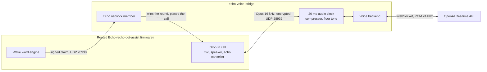

# echo-voice-bridge

[](https://github.com/EinMelih/echo-voice-bridge/actions/workflows/ci.yml)

Turns a rooted Amazon Echo into a natural, full-duplex voice assistant. Say the wake word, talk, interrupt whenever you like. The Echo keeps doing what it is good at (far-field microphones, echo cancellation, wake word detection), and a small server bridges the conversation to a realtime speech model.



> **Status: early, and the Realtime backend has not been run against the live OpenAI API yet.** It is written from the API docs and tested against a local stand-in, so expect to fix details on first contact. The Echo side (network, calls, audio processing) has been used in real conversations on an Echo Dot 3, with ChatGPT's voice mode as a private backend.

## How it works

The [echo-dot-assist](https://github.com/Gamer92000/echo-dot-assist) firmware replaces the Alexa client on an Echo with an open one, and lets Echos on a network settle who answers a wake word and call each other. This project speaks those protocols, so to the Echo it is just another Echo:

1. **Wake word:** when the Echo hears its wake word, it broadcasts a signed claim. The bridge answers with a winning claim, so the Echo stays out of its own voice pipeline.
2. **Call:** the bridge calls the Echo over Drop In. That gives encrypted two-way audio and puts Amazon's audio front end into its call mode, whose echo canceller is tuned for this.
3. **Conversation:** a 20 ms clock moves audio between the call and the voice backend, buffering whatever you say while the session connects.
4. **Standby:** after a configurable silence, or when you hang up, the call ends and the microphone is closed again. No audio leaves the Echo between conversations.

If the bridge is down, nothing breaks: the Echo answers its wake word itself. While it is playing media or ringing a timer the bridge leaves the wake word alone, so "Alexa, stop" keeps working.

### Why interrupting needed a trick

The firmware was built for calls between people, so it drops the microphone by 25 dB whenever the other side plays audio. With a speech model that says "mhm" while you talk, this cut off a second of every sentence, and the model took that for the end of your turn.

The firmware decides "the other side is talking" by comparing the played level with the quietest level it played recently (a 25 dB margin). So the bridge mixes in a steady 50 Hz tone at −36 dBFS, which the small speaker barely reproduces, and keeps speech under that margin. The microphone stays open. Details in [docs/protocol.md](docs/protocol.md).

## Requirements

- An Echo running [echo-dot-assist](https://github.com/Gamer92000/echo-dot-assist). Developed against `v2026.11.05.000019-beta` on an Echo Dot 3. The protocols are not a stable API, so other versions may need changes. Keep online updates off.
- Home Assistant with the Echo adopted (the Echo gets the network key through it).
- A Linux host on the same subnet, with Docker. It needs the host network for UDP broadcast.
- An OpenAI API key. **Usage is billed by OpenAI.** Set a spending limit.

## Setup

```bash
cp .env.example .env   # fill in OPENAI_API_KEY, EVB_ECHO_NODE, EVB_HA_URL, EVB_HA_TOKEN
docker compose up -d --build
curl -s localhost:8099/status          # "echo" appears once the Echo has joined
curl -s -X POST localhost:8099/call    # test call without the wake word
curl -s -X POST localhost:8099/hangup
```

Then pick a wake word on the Echo in Home Assistant. Hang up with the action button or "<wake word>, stop".

To show your own light during conversations, set `EVB_HA_LIGHT` and, on the Echo's settings page, give "call connected" a design that ends in black. Otherwise the firmware's own call animation covers the light.

## Configuration

See [.env.example](.env.example). Audio settings for tuning, with their defaults:

| Variable | Default | Purpose |
|---|---|---|
| `EVB_OPEN_MIC` | `1` | Floor tone that keeps the microphone open. It only takes effect about 20 s into a call, because the firmware raises its floor by 1.5 dB/s |
| `EVB_REPLY_DBFS` | `-17` | Target level of the assistant's voice |
| `EVB_MIC_GAIN_DB` | `12` | Gain on the microphone. The firmware's gate leaves quiet speech low |
| `EVB_BARGE_IN_RMS` | `400` | While a reply plays, quieter microphone frames count as echo and are not sent |
| `EVB_VAD` | `semantic_vad` | Turn detection, or `server_vad` |

Each session logs its levels and they appear under `last_session` in `/status`.

## Other backends

Backends implement the small [`VoiceBackend`](src/echo_voice_bridge/backends/base.py) interface. Only the OpenAI Realtime API is included.

The bridge also works with ChatGPT's voice mode (GPT-Live) through a browser session. That is how I run it at home. It is not included here, I don't explain how to set it up, and I don't support it. Check the provider's terms before trying anything like that.

## Limits

- **Sound quality:** Drop In carries 16 kHz audio, so voices have no content above 8 kHz. Clear, but like a very good phone call.
- **Barge-in:** Simultaneous speech depends on room and volume. At high volume the canceller's leftovers can interrupt the assistant; raise `EVB_BARGE_IN_RMS` or lower the volume.
- **First words:** whatever you say before the wake word's round is over is not captured, so speak after the chime.
- **Scope:** one Echo per bridge.

## Security

- The network key in `state/identity.json` lets its holder open the Echo's microphone. Treat it like a password.
- Status and test endpoints listen on localhost only.
- Conversations go to OpenAI while a session runs. Transcripts are kept locally only if `EVB_TRANSCRIPT_DIR` is set.

## Development

```bash
pip install -e ".[dev]"   # needs libopus0
ruff check . && pytest -q
```

The tests run whole sessions against a simulated Echo that speaks the real packet formats over loopback, and the Realtime backend against a local stand-in for the API. Crypto is checked against vectors from the firmware's Monocypher build.

## Credits

Built on the protocols of [echo-dot-assist](https://github.com/Gamer92000/echo-dot-assist) by Julian Imhof (MIT). This project contains no firmware code. It is not affiliated with Amazon or OpenAI.

Developed with AI assistance (Claude).

## License

[MIT](LICENSE)
